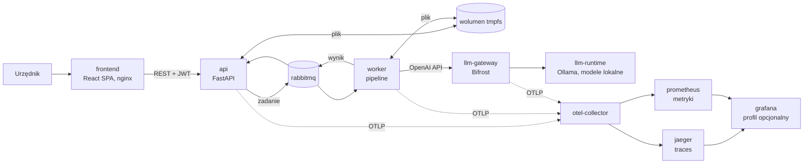
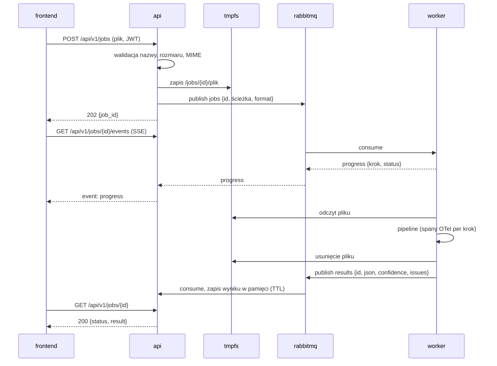
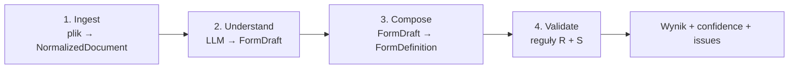

# Architektura

Szkic na 2026-11-21. Każda decyzja technologiczna ma swój [ADR](adr/README.md). Wymagania: [requirements.md](requirements.md).

## 1. Cel w jednym zdaniu

Urzędnik wgrywa blankiet formularza (PDF/DOC/DOCX/ODS/XLSX/JPG/PNG), a system zwraca JSON konfiguracji eUsługi z oceną pewności każdego elementu. Urzędnik poprawia wynik w panelu.

## 2. Usługi (kontenery)



| Usługa | Odpowiedzialność | Technologia | ADR |
|---|---|---|---|
| `frontend` | Upload, lista zadań, edytor JSON, podgląd formularza, confidence score | React + Vite + TypeScript, serwowany przez nginx bez roota | [0011](adr/0011-frontend-react-vite.md) |
| `api` | JWT, walidacja pliku (FR-02..05), zapis do tmpfs, publikacja zadania, zwrot wyniku (tryb sync i async) | FastAPI | [0002](adr/0002-python-fastapi.md), [0004](adr/0004-przetwarzanie-asynchroniczne-rabbitmq.md) |
| `rabbitmq` | Kolejka `jobs` i `results`, wiadomości nietrwałe | RabbitMQ | [0004](adr/0004-przetwarzanie-asynchroniczne-rabbitmq.md) |
| `worker` | Pipeline: ekstrakcja → rozumienie → kompozycja → walidacja | czysty Python | [0006](adr/0006-pipeline-czysty-python.md) |
| `llm-gateway` | Jeden punkt wejścia do modeli: routing, limity, koszty, wyłącznik LLM, telemetria | Bifrost (propozycja) | [0008](adr/0008-bramka-llm.md) |
| `llm-runtime` | Lokalne małe modele z API zgodnym z OpenAI | Ollama | [0007](adr/0007-lokalny-runtime-llm.md) |
| `otel-collector` | Odbiór OTLP, przetwarzanie, eksport | OpenTelemetry Collector | [0009](adr/0009-obserwowalnosc-opentelemetry.md) |
| `jaeger`, `prometheus` | Traces, metryki | Jaeger, Prometheus | [0009](adr/0009-obserwowalnosc-opentelemetry.md) |
| `grafana` | Dashboardy: latencja, koszty, tokeny, błędy, confidence | Grafana (profil `observability`, licencja AGPL: patrz K-03) | [0009](adr/0009-obserwowalnosc-opentelemetry.md) |

Profile `docker compose`:
- domyślny: `frontend`, `api`, `rabbitmq`, `worker`, `llm-gateway`, `llm-runtime`, `otel-collector`;
- `observability`: `jaeger`, `prometheus`, `grafana`.

## 3. Przepływ żądania



Postęp na żywo (FR-T5, [ADR-0014](adr/0014-sse-postep-pipeline.md)): worker publikuje zdarzenia kroków do exchange `progress`, a frontend słucha `GET /api/v1/jobs/{id}/events` (SSE przez `fetch`, z nagłówkiem JWT). Polling `GET /api/v1/jobs/{id}` zostaje jako zapas.

Tryb synchroniczny (`POST /api/v1/forms:convert`) robi to samo, ale czeka na wynik do `SYNC_TIMEOUT_SECONDS` i zwraca JSON w odpowiedzi (FR-01, FR-06). Po przekroczeniu limitu zwraca `202` z `job_id`.

Gwarancje NFR-06 (pliki tylko tymczasowo):
- plik leży na wolumenie `tmpfs` (RAM), nigdy na dysku;
- worker usuwa plik po zakończeniu zadania, a sprzątacz usuwa pliki starsze niż `FILE_TTL_SECONDS`;
- wiadomości w RabbitMQ są nietrwałe (`delivery_mode=1`), kolejki nie są `durable`;
- wynik (JSON) trzymamy w pamięci API z TTL. Wynik nie zawiera pliku.

## 4. Pipeline w workerze



| Krok | Wejście → wyjście | AI? | Opis |
|---|---|---|---|
| 1. Ingest | bajty pliku → `NormalizedDocument` (bloki tekstu, tabele, strony, pola wyboru) | tylko OCR dla obrazów | Adapter per format. DOC → konwersja przez LibreOffice headless. Obrazy cięte na strony A4. |
| 2. Understand | `NormalizedDocument` → `FormDraft` | **tak** | LLM wyciąga: tytuł, adresata, kto może złożyć wniosek (osoba / inna osoba / podmiot / pełnomocnik), pola przedmiotu wniosku z typem, warunki, załączniki, opłaty, zgody. Wyjście strukturalne (JSON Schema), z confidence per element. |
| 3. Compose | `FormDraft` → `FormDefinition` | nie | Deterministycznie: bloki predefiniowane ze Standardów, strony tematyczne, layout `x/y/rows/cols`, UUID, `techName`, JSONata, słowniki, dane inicjalne, `flow`. |
| 4. Validate | `FormDefinition` → lista `Issue` | nie | Reguły techniczne (FR-08) + Standardy (FR-09) + schemat (FR-06). Naruszenia obniżają confidence. |

Każdy krok to klasa z interfejsem `PipelineStep` (ABC). Pipeline to lista kroków wykonywana po kolei. Na granicy każdego kroku jedno miejsce w `Pipeline` otwiera span OTel i publikuje zdarzenie postępu (SSE). Więcej: [ADR-0006](adr/0006-pipeline-czysty-python.md).

Dlaczego AI jest tylko w kroku 2: 85–93% wzorcowego JSON-a to powtarzalne bloki ze Standardów ([analiza §3](analiza-i-charakterystyka-danych.md#3-części-wspólne-gotowe-bloki-ze-standardów)). Generowanie ich kodem jest tańsze, szybsze i zawsze zgodne z regułami.

### Confidence score (FR-T1)

| Źródło sygnału | Przykład |
|---|---|
| OCR | średnia pewność rozpoznania słów w bloku |
| LLM | logprobs (jeśli runtime je udostępnia), inaczej pewność zgłoszona przez model w wyjściu strukturalnym |
| Reguły | element naruszający regułę R/S dostaje karę |
| Pochodzenie | element z bloku predefiniowanego ma 1.0 |

Wynik ogólny to ważona średnia. Frontend podświetla elementy poniżej progu `CONFIDENCE_REVIEW_THRESHOLD`.

## 5. Architektura heksagonalna (backend)

Domena i logika aplikacji nie znają FastAPI, RabbitMQ ani Ollamy. Rozmawiają z porami (ABC). Adaptery implementują porty. Szczegóły: [ADR-0003](adr/0003-architektura-heksagonalna-abc.md), zasady: [coding-rules.md](coding-rules.md).

```
backend/
├── pyproject.toml
├── src/forms2json/
│   ├── domain/                  # czysty Python, zero importów z frameworków
│   │   ├── form_definition.py   # model wyjściowy (title, tabs, flow)
│   │   ├── form_draft.py        # model pośredni z kroku Understand
│   │   ├── blocks/              # bloki predefiniowane ze Standardów
│   │   ├── layout.py            # x/y/rows/cols, questionOrder
│   │   ├── jsonata.py           # budowanie warunków SHOW / READ_ONLY
│   │   └── rules.py             # reguły R i S → Issue
│   ├── application/
│   │   ├── ports/               # ABC: DocumentReader, OcrEngine, LlmClient,
│   │   │                        #      JobQueue, FileStore, ResultStore
│   │   ├── pipeline/            # PipelineStep (ABC) + kroki 1–4
│   │   └── use_cases/           # SubmitJob, ProcessJob, GetJobResult
│   ├── adapters/
│   │   ├── inbound/
│   │   │   ├── http/            # FastAPI: routery, schematy, JWT
│   │   │   └── worker/          # konsument RabbitMQ → ProcessJob
│   │   └── outbound/
│   │       ├── readers/         # docx, pdf, xlsx, ods, doc, image
│   │       ├── ocr/
│   │       ├── llm/             # klient OpenAI-compatible (przez bramkę)
│   │       ├── queue/           # RabbitMQ
│   │       └── storage/         # tmpfs FileStore, in-memory ResultStore
│   ├── config.py                # pydantic-settings, jedno miejsce konfiguracji
│   └── bootstrap.py             # composition root: składa adaptery z portami
└── tests/
    ├── unit/                    # domena i pipeline z fałszywymi adapterami
    ├── integration/             # adaptery z prawdziwymi usługami
    └── evals/                   # runner ewaluacji (ADR-0010)
```

Kierunek zależności: `adapters → application → domain`. Nigdy odwrotnie.

`bootstrap.py` to jedyne miejsce, które tworzy konkretne adaptery. Przy starcie aplikacji instancjonuje wszystkie adaptery. ABC rzuca `TypeError`, jeśli któryś adapter nie implementuje metody portu, więc niekompletne okablowanie wykrywamy przy starcie, a nie przy pierwszym żądaniu.

## 6. Frontend

```
frontend/
├── src/
│   ├── app/                 # providery (QueryClient, router), layout
│   ├── features/
│   │   ├── upload/          # wgrywanie, walidacja po stronie klienta
│   │   ├── jobs/            # lista zadań, postęp na żywo (SSE), polling jako zapas
│   │   ├── json-editor/     # edycja JSON, walidacja schematem
│   │   └── form-preview/    # render formularza z JSON (FR-E5)
│   ├── shared/
│   │   ├── api/             # klient HTTP + typy generowane z OpenAPI
│   │   └── ui/              # wspólne komponenty
│   └── main.tsx
└── tests/e2e/
```

Typy API generujemy z OpenAPI FastAPI, więc kontrakt ma jedno źródło prawdy. Szczegóły: [ADR-0011](adr/0011-frontend-react-vite.md), zasady: [coding-rules.md §3](coding-rules.md#3-frontend).

## 7. Obserwowalność

| Sygnał | Źródło | Gdzie |
|---|---|---|
| Trace żądania end-to-end | OTel SDK w `api` i `worker`, propagacja kontekstu w nagłówkach wiadomości RabbitMQ | Jaeger |
| Span per krok pipeline'u i per wywołanie LLM | OTel, konwencje GenAI (`gen_ai.*`) | Jaeger |
| Latencja, liczba żądań, błędy | OTel metrics | Prometheus → Grafana |
| Tokeny i koszt per żądanie | bramka LLM + atrybuty `gen_ai.usage.*` | Prometheus → Grafana |
| Confidence ogólny per zadanie | metryka z workera | Prometheus → Grafana |

Koszt modeli lokalnych to nie faktura, tylko czas obliczeń. Liczymy go z konfigurowalnej stawki (`COST_PER_1K_TOKENS` lub `COST_PER_GPU_SECOND`), żeby porównywać modele i pokazać koszt wdrożenia (NFR-13).

## 8. Ewaluacje

Zbiór: 2 wzorce + złote JSON-y dla formularzy 2, 3, 4, 6, 7, 8, 9 przygotowane przez nas ręcznie. Metryki: zgodność z regułami, recall i precision sekcji i pól względem złotego JSON-a, trafność typów, trafność warunków, confidence vs faktyczne błędy. Runner na pytest. Szczegóły: [ADR-0010](adr/0010-ewaluacje-pytest.md).

Poprawki urzędnika z panelu (FR-T2) eksportujemy jako pliki JSON. Można je dodać do zbioru ewaluacyjnego ręcznie przez PR. Serwer niczego nie zapisuje trwale (NFR-06).

## 9. Otwarte kwestie

| # | Kwestia | Status |
|---|---|---|
| 1 | Wybór modelu (Bielik vs Qwen, rozmiar) i OCR | do ADR po pierwszych evalach |
| 2 | Grafana a zakaz AGPL (K-03) | pytanie do mentorów |
| 3 | Bifrost: sprawdzić plik LICENSE i czy potrzebne funkcje są w wersji OSS | do weryfikacji przed implementacją |
| 4 | Formularz 9 (3 w 1): SHOW czy strony alternatywne w `flow` | pytanie do mentorów |
